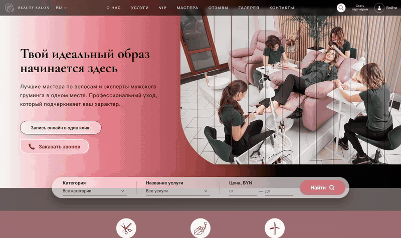
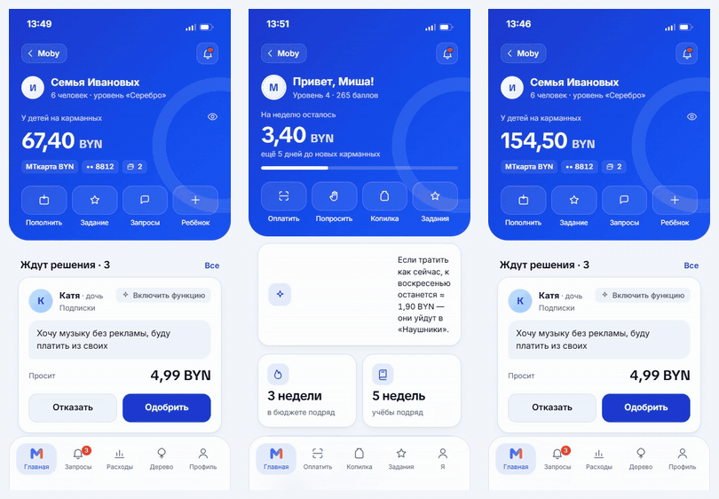
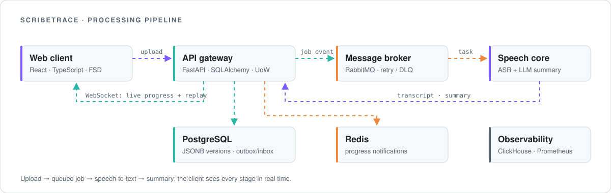

<picture>
  <source media="(prefers-color-scheme: dark)" srcset="assets/header-dark.svg">
  
</picture>

  
  
  
  

I build backend services and REST APIs with Django and DRF, and take features end to end when they need a React frontend. Right now I lead the development team of a beauty-salon booking platform: planning tasks, reviewing pull requests and writing a large part of the backend. At hackathons I work on backend services and the ML parts of the product.

## Tech stack

  

  

## Featured projects

### Beauty Booking &nbsp;·&nbsp; [API](https://github.com/mat-htt/beauty-single-backend) · [Web](https://github.com/mat-htt/beauty-booking-frontend)

Website for a beauty salon with online booking: service catalog, masters' schedules, client and master accounts, reviews, promotions and an admin panel. Team project — I lead the team of 17 and own most of the backend.

- Booking rules: slot limits, no booking in the past, confirmation by link, loyalty bonuses
- Auth and accounts for clients and masters, masters' social links, promotions API
- Whole project starts with one `docker compose up`

    

### Family in Moby &nbsp;·&nbsp; private team repo, code on request

MTBank Hackathon 2026. Family banking inside the bank's mobile app: parents manage their kids' money, set limits and approve requests; kids save for goals and learn through mini-lessons.

- Backend: 12 FastAPI microservices behind a gateway, events over RabbitMQ, PostgreSQL per service
- ML service: anti-fraud scoring of kids' payments, merchant auto-categorization, "will the money last until the end of the week" forecast
- Frontend in React + TypeScript, designed to fit the Moby app

     

### ScribeTrace &nbsp;·&nbsp; private team repo, code on request

MTS Hackathon. Platform for audio and video transcription with automatic summaries: upload a recording and watch every processing stage live.

- Worked on the backend and on connecting the speech-to-text and summary models to the pipeline
- Built the web client: upload, history, live progress over WebSocket, transcript and summary views

     

<picture>
  <source media="(prefers-color-scheme: dark)" srcset="assets/scribetrace-dark.svg">
  
</picture>

## Experience

**Team Lead / Backend Developer** — beauty booking platform · *present* 
Lead a team of 17: task planning, code review on GitHub, regular syncs. Backend on Django/DRF: booking logic, authentication for clients and masters, promotions API, Docker setup.

**Full-Stack Developer** — [CourseHub](https://coursehub.it.com), online learning platform · *2025* 
Joined after the internship and worked on the product: navigation bar, settings page with theme switching, mobile layout, video player built from Figma designs in React and connected to the DRF backend. Commercial code, not public.

**Telegram bots & Mini Apps** — commercial projects · *until 2026* 
Bots and mini apps on aiogram.

**Education** — Minsk State Radio Engineering College, Information Systems Development and Maintenance *(in progress)*

---

<b>На русском</b>

 

**Python backend-разработчик** · Django · DRF · PostgreSQL · Минск

Пишу бэкенд и REST API на Django и DRF, при необходимости закрываю задачу целиком вместе с фронтендом на React. Сейчас руковожу командой разработки платформы онлайн-записи для салона красоты: ставлю задачи, делаю ревью pull request'ов и пишу значительную часть бэкенда. На хакатонах занимаюсь бэкендом и ML-частью продукта.

**Проекты**
- **Beauty Booking** — сайт салона красоты с онлайн-записью к мастерам, кабинетами клиента и мастера, отзывами и акциями. Django/DRF + React, запуск через Docker Compose. Командный проект, я тимлид.
- **«Семья в Moby»** — хакатон МТБанка 2026. Семейный банкинг внутри приложения банка: 12 микросервисов на FastAPI, RabbitMQ, PostgreSQL; ML-сервис (антифрод-скоринг, автокатегоризация трат, прогноз «хватит ли денег до конца недели»); фронт на React + TypeScript.
- **ScribeTrace** — хакатон МТС. Расшифровка аудио и видео с автоматическим конспектом: бэкенд, подключение моделей распознавания речи и саммари, веб-клиент с прогрессом в реальном времени.
- **CourseHub** — образовательная платформа: навигация, настройки с темами, адаптив, видеоплеер (React + DRF). Коммерческий код, не публикуется.

**Связь:** [matsvei.v@gmail.com](mailto:matsvei.v@gmail.com) · Telegram [@mt_voyt](https://t.me/mt_voyt)

